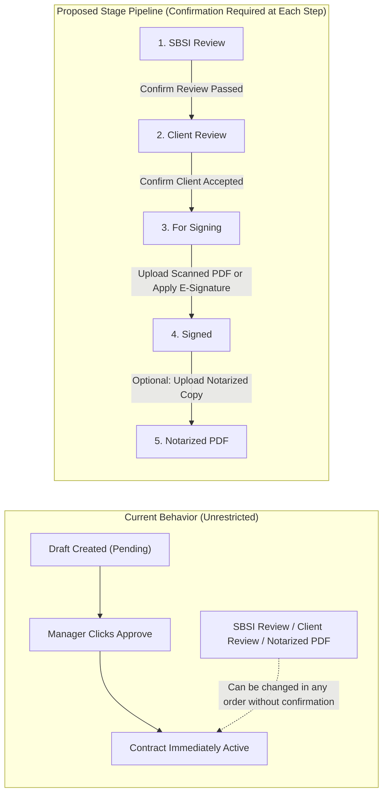
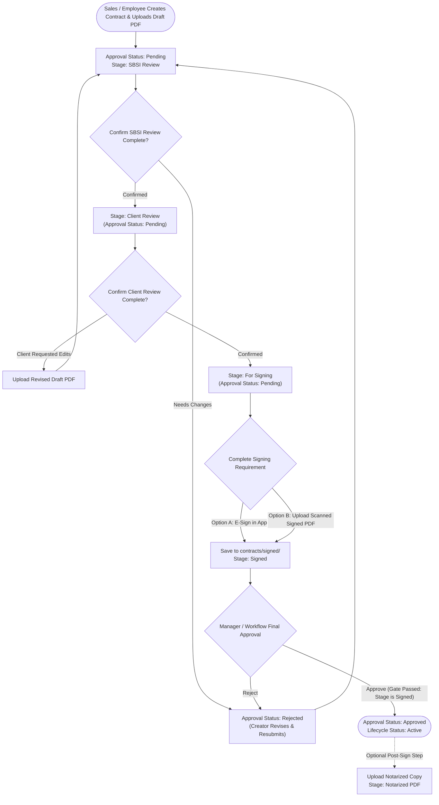
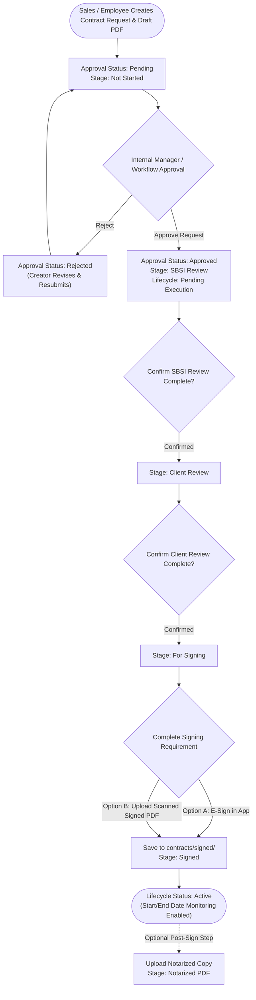
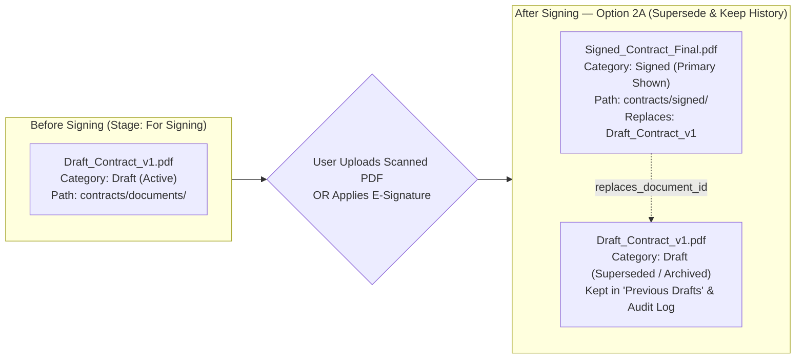
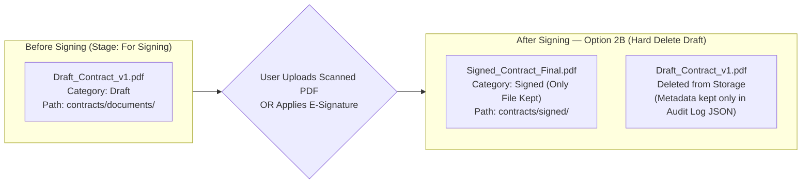
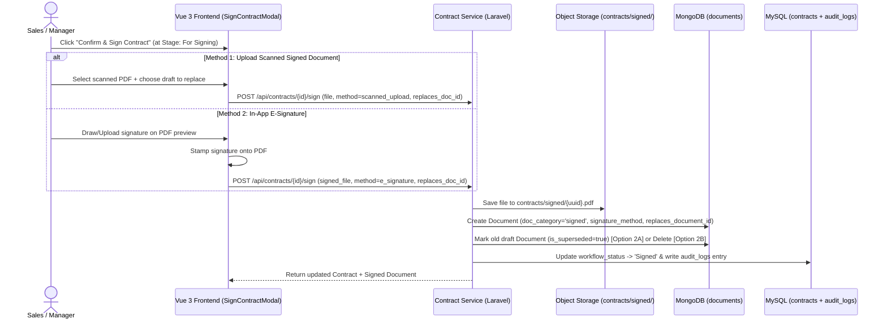

# Contract Status, Stage Workflow & E-Signature / Signed Document Proposal

## 1. Executive Summary

Currently, the Contract Management System (CMS) tracks two separate status fields on a contract:
1. **Approval Status (`approval_status`)**: `Pending`, `Approved`, `Rejected`
2. **Workflow Stage (`workflow_status`)**: `SBSI Review`, `Client Review`, `Notarized PDF`

**Current Gap:**
- `workflow_status` can be changed freely without step-by-step confirmation.
- A contract becomes `Active` as soon as `approval_status` is set to `Approved`, even if the contract has not completed `SBSI Review`, `Client Review`, or been signed.
- Unsigned draft documents and signed/executed documents share the same storage path and metadata structure, with no built-in flow to replace a draft with a scanned signed copy or e-signature.

**Proposed Solution:**
- Turn **Workflow Stage** into a gated, step-by-step pipeline (`SBSI Review` -> `Client Review` -> `For Signing` -> `Signed` -> `Notarized PDF`) where each step requires explicit user confirmation.
- Add a **Signing Gate** (`For Signing` -> `Signed`) that requires either:
  1. **Uploading a Scanned Signed Document**, or
  2. **Applying an In-App E-Signature**
- Store signed documents in a dedicated storage prefix (`contracts/signed/`) with metadata linking them to the draft document they replace.

---

## 2. Current System vs. Proposed Stage Pipeline

---

## 3. Decision 1: Order of Manager Approval vs. Review & Signing Stages

Please select which workflow matches our business process (**Option 1A** or **Option 1B**).

### Option 1A: Review & Sign While `Pending`, Final Manager Approval Unlocks `Active`
In this flow, the contract stays in `Pending` while Sales and Legal/SBSI move it through `SBSI Review`, `Client Review`, and `For Signing`. Once the signed document is uploaded/e-signed (`Signed`), the Manager gives final approval to make the contract `Active`.

---

### Option 1B: Internal Approval First, Then Review & Signing Before Becoming `Active`
In this flow, the Manager/Approval Workflow approves the internal contract request first (`Pending` -> `Approved`), which unlocks the external review and signing pipeline. However, the contract lifecycle remains `Pending Execution` (not `Active`) until it reaches `Signed`.

### Comparison Summary for Decision 1

| Criteria | Option 1A (Sign before Final Approval) | Option 1B (Internal Approval first, Sign before Active) |
| :--- | :--- | :--- |
| **When Manager Approves** | At the end, verifying the signed contract is complete before activating. | At the start, authorizing Sales to send the contract to SBSI/Client. |
| **What `Approved` Means** | Fully executed and `Active`. | Internally approved to proceed with external review & signing. |
| **Key Gate for `Active`** | Cannot click `Approve` until stage is `Signed` with a signed file. | `Approved` unlocks stages; contract only turns `Active` once stage is `Signed`. |

---

## 4. Decision 2: Handling the Existing Draft Document When Signing

When a user is at the `For Signing` stage and either applies an **E-Signature** or uploads a **Scanned Signed PDF**, how should the system handle the original unsigned draft PDF?

### Option 2A: Archive / Supersede Original Draft (Recommended)
The new signed PDF becomes the **Primary Active Document** stored under `contracts/signed/`. The original draft PDF is kept in storage, marked as `Superseded / Previous Draft`, and moved to a collapsible history section for audit compliance.

---

### Option 2B: Hard-Replace (Overwrite / Delete Old Draft)
The new signed PDF is stored in `contracts/signed/`, and the old unsigned draft file is permanently deleted from storage so only the signed file remains on the contract.

### Comparison Summary for Decision 2

| Criteria | Option 2A: Supersede & Archive (Recommended) | Option 2B: Hard-Delete Draft |
| :--- | :--- | :--- |
| **Audit & Legal Traceability** | High — reviewers can compare the original draft against the scanned signed PDF. | Low — original draft file is deleted; only audit log text remains. |
| **UI Cleanliness** | Clean — primary view shows the **Signed Document**; drafts are tucked in a "Previous Drafts" drawer. | Clean — only one file exists. |
| **Storage Impact** | Minimal (1 extra PDF per contract). | Lowest (old file deleted). |

---

## 5. Signing & Document Storage Architecture

Regardless of whether E-Signature or Scanned Upload is chosen for a contract, both use the same unified signing gate and isolated storage path:

---

## 6. Sign-Off Checklist for Project Manager

- [ ] **Decision 1 (Workflow Order):**
  - [ ] **Option 1A:** Complete `SBSI Review` -> `Client Review` -> `For Signing` -> `Signed` *while* `Pending`, before final Manager `Approve`.
  - [ ] **Option 1B:** Manager `Approve` comes first, then contract steps through `SBSI Review` -> `Client Review` -> `For Signing` -> `Signed` before becoming `Active`.
- [ ] **Decision 2 (Draft Document Replacement):**
  - [ ] **Option 2A:** Archive/supersede the unsigned draft under "Previous Drafts" when the signed PDF is uploaded/e-signed.
  - [ ] **Option 2B:** Permanently delete the unsigned draft file when replaced by the signed PDF.
- [ ] **Stage List Confirmation:** Are the 5 stages (`SBSI Review` -> `Client Review` -> `For Signing` -> `Signed` -> `Notarized PDF`) exact, or should any stage name be added/renamed?

